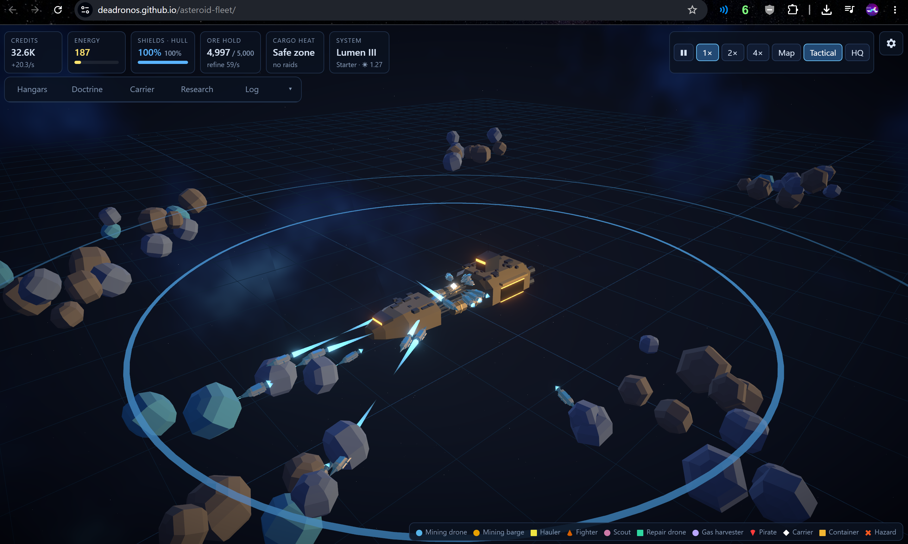

# Asteroid Fleet

A browser idle game with an autobattler setup, in full 3D. You are the admiral, not the pilot: outfit a mining carrier's hangars, set stances and rules, and warp outward into richer, more dangerous systems while the fleet works on its own. See [asteroid-fleet-game-concept.md](asteroid-fleet-game-concept.md) for the design.

## Screenshot


## Run it

```sh
pnpm install
pnpm run dev       # http://localhost:5173/asteroid-fleet/
pnpm test          # simulation tests
pnpm run test:e2e # Playwright smoke test against the built preview
pnpm run build     # typecheck + production build into dist/
pnpm run balance   # 2-hour headless economy run, prints income every 10 min
pnpm run lint      # oxlint, type-aware via tsgolint (works with TypeScript 7)
pnpm run format    # oxfmt; format:check verifies without writing
```

The game is published to GitHub Pages at https://deadronos.github.io/asteroid-fleet/ . Pushing a `v*` tag (for example `git tag v0.0.1 && git push origin v0.0.1`) deploys it, but only after the CI checks and the Playwright smoke test pass.

pnpm keeps one package store on the machine, so another git worktree reuses packages that are already downloaded.

CI runs on every pull request and on pushes to `main`, on Node 22 with pnpm 12. The checks are `pnpm install --frozen-lockfile`, `pnpm run lint`, `pnpm run format:check`, `pnpm run typecheck`, `pnpm test`, and `pnpm run build`. The two-hour `pnpm run balance` script is local only and is skipped in CI.

## What is in this first playable slice

| Concept area                                              | Status                                                                                                                                                                                                                                                                                                                                                                                                                                                  |
| --------------------------------------------------------- | ------------------------------------------------------------------------------------------------------------------------------------------------------------------------------------------------------------------------------------------------------------------------------------------------------------------------------------------------------------------------------------------------------------------------------------------------------- |
| Logistics chain drone → barge → hauler → carrier refinery | Playable. Barges park at rich clusters as depots; the Carrier tab shows the throughput links and the current bottleneck.                                                                                                                                                                                                                                                                                                                                |
| Hangars as the board                                      | Slot sizes (drone 1, fighter/hauler 2, harvester 3, barge 4), drag-and-drop between slots, launch order per hangar, launch bay / cargo bay / dry dock (frontier) / fabrication bay (deep space) types, repair-drone adjacency synergy.                                                                                                                                                                                                                  |
| Stances                                                   | Fleet → ship type → hangar scopes, most specific wins. Engagement (aggressive, defensive, escort, passive), under fire (stand, retreat at X % hull, unload first), mining (greedy, safe).                                                                                                                                                                                                                                                               |
| Rules                                                     | Condition/action cards (up to 12): a scope (fleet, ship type or hangar), 1–3 conditions joined by AND, one action. The most specific scope wins, then card order. Actions unlock by zone, each dealt as a preset card: drones unload at barges, barges call a hauler, haulers park (starter); fighters escort on wave, barges fall back, recall on low shields, keep warp energy in reserve (frontier); harvesters shelter from H2 storms (deep space). |
| Modules & scouts                                          | Fit modules per ship (mining laser, core drill, tractor beam, shield emitter, ore compressor; 1–2 slots by class). Scouts survey clusters, mark rich veins for drones and chart hazards so drones steer clear.                                                                                                                                                                                                                                          |
| Automation                                                | Research unlocks auto-buy toward a per-hangar target and paid auto-rebuild of lost ships, both kept above a credit floor.                                                                                                                                                                                                                                                                                                                               |
| Zones                                                     | 10 systems across starter, frontier and deep space, two with gas giants. Pirate waves scale with distance and cargo heat; debris and radiation hazards; solar storms, H2 storms around gas giants.                                                                                                                                                                                                                                                      |
| Carrier                                                   | One energy pool (solar, later fusion from H2) feeding refinery, shields, warp and drift; power modes; sublight "follow richest cluster"; warp with charge time, automatic recall, and losses for ships left outside.                                                                                                                                                                                                                                    |
| Prestige & research                                       | RP = ⌊√(ore value delivered ÷ 10,000)⌋ × furthest tier. Hybrid tree: global branches plus one small branch per ship class, loss-buffer reserves.                                                                                                                                                                                                                                                                                                        |
| Offline                                                   | Settled from timestamps at 50 % of recent mining income (salvage excluded), no pirate waves, energy recharges from solar, reserves keep rebuilding. Offline credits do not count toward RP.                                                                                                                                                                                                                                                             |
| Save                                                      | IndexedDB with localStorage fallback, manual save slots and text export/import from the ☰ menu.                                                                                                                                                                                                                                                                                                                                                        |
| Rendering                                                 | React Three Fiber, low-poly glTF ships and asteroids (Kenney Space Kit) with an instanced placeholder LOD at distance, engine trails, line-segment beams, bloom, nebula skybox, tactical sensor view (toggle or zoom far out), low-quality mode with a frame cap.                                                                                                                                                                                       |

## Choices made for the open questions

1. **Energy at zero**: shields stop regenerating and refining stops, but the carrier is never stranded because solar keeps trickling in.
2. **H2**: fusion fuel only, not direct warp fuel.
3. **Reserves offline**: reserve ships keep rebuilding on their cooldown while you are away.
4. **Rule depth**: fixed rule cards with one parameter each, as a first step before building blocks.

## Save migrations

Saves are JSON documents stamped with `SAVE_VERSION` (`src/sim/state.ts`). On load, and again on import, `migrate()` (`src/game/migrate.ts`) brings an older save up to that version. It runs one step per version, in order: `migrations[n]` rewrites a version `n` save into version `n + 1`, then the next step runs, until `SAVE_VERSION`. Steps run on the raw JSON, before timers are restored: a wave or storm timer that means "never" is still `null` there, because that is how `Infinity` survives `JSON.stringify`.

Every save schema change needs all three of these:

1. Bump `SAVE_VERSION`.
2. Add the `migrations[n]` step that upgrades the previous version to the new one.
3. Check in a fixture of the previous version under `src/game/fixtures/` and a test that loads it and migrates it to the current version. `src/game/fixtures/save-v1.json` is the v1 fixture `save-v2.json` the v2 one (automation, #11) `save-v3.json` the v3 one (field records, #14) `save-v4.json` the v4 one (containers, #13), `save-v5.json` the v5 one (modules, #9) `save-v6.json` the v6 one (`miningIncomeAvg`, #38) and `save-v7.json` the v7 one (plain-text log, #72). Every fixture is also migrated and run through `step()` in `src/game/save.test.ts`.

v3 added `fields`: when the carrier leaves a system it keeps a compact depletion record (`[index, oreFraction, respawn]` for each rock that is not full). On return the field is regenerated from the seed, the record applied, and refill added for the sim time spent away (depleted timers count down, partly mined rocks refill over `FIELD_REFILL_SECS`). All records together stay under 16 KB of save, tested in `src/sim/fields.test.ts`.

v4 added `containers` (cargo dropped by destroyed barges, salvaged by haulers until it decays) and `Ship.bargeId` (the barge whose drone bay a drone is based at, `-1` for the carrier).

v5 added `Ship.modules` (fitted modules, at most `MODULE_SLOTS[cls]`) and `recon` (clusters surveyed, rich vein asteroid ids and charted hazard indices in the current system; cleared on every jump).

v6 (#38) guarantees `miningIncomeAvg` is a finite number: older saves lacked it, which made offline settlement pay nothing. `save-v5.json` is the fixture without it, and `validateSave` also repairs a non-finite value.

v7 (#40): every asteroid now draws its rare-ore roll whether or not rare ore is researched, so researching it no longer shifts the rocks after the first rare roll and a restored depletion record stays on the right rocks. That changes how fields generate, so the v7 step drops the old `fields` records (the current system's rocks are saved as-is; other systems simply come back full). `validateSave` also rebuilds a missing or empty `systems` list from `seed` (early saves had `systems: []`).

v10 (#75): per-carrier state moves into `ops: Operation[]`, so several carriers can be played at once later (#53). The carrier, hangars, ships, pirates, asteroids, containers, hazards, recon, `systemId`, warp, wave, storm, reserve timers, fx, `rng` and the income averages of a v9 save become operation `0`; credits, research, unlocks, cards, stats and the event log stay on the top level. `save-v9.json` is the fixture.

v11 (#65): hull classes. `GameState.hulls` lists the unlocked classes (a v10 save has only `standard`) and each carrier gets `hullClass: 'standard'`. `save-v10.json` is the fixture.

v15 (#71): run modifiers and challenge runs. `GameState.modifiers` (active run modifiers), `challenge` (the attempt in progress) and `challengesDone` (completed challenges, permanent). A v14 save gets none of them. `save-v14.json` is the fixture. The modifier framework is `src/sim/modifiers.ts`; each modifier is read through one hook there.

The primary save lives in IndexedDB; the localStorage copy is only written when IndexedDB cannot hold it, and a stale one is removed, so a large fleet does not fill the localStorage quota the save slots use. A failed autosave or active-slot write shows a toast once, until a write succeeds again.

A save that is corrupt, from a newer version than this build, or otherwise unknown is not deleted and not overwritten. The raw text is copied to `asteroid-fleet-save-backup` in both IndexedDB and the localStorage fallback (the same pair of stores as the primary key `asteroid-fleet-save`). A later failure that is byte-for-byte the same does not rewrite that copy. A different failure is written to `asteroid-fleet-save-backup-<timestamp>` so the earlier backup stays. Only the newest five backups (`MAX_BACKUPS`) are kept in each store. The game shows "Your save could not be loaded and was backed up." and pauses automatic saving so the original stays put. If both stores reject the copy, it shows "could not be backed up" instead, and a reset or import then warns that the save will be lost. A hard reset or a successful import may reuse the primary slot; backup keys are left alone. A bad import is rejected and does not write any key.

## Layout

- `src/sim/`: deterministic simulation (seeded RNG, fixed 10 Hz tick), pure TypeScript with no React or three.js. `step(global, op)` in `tick.ts` is the whole game loop for one operation (carrier); the sim works on a `Sim`, the run-wide state and one operation bound together by `bind()` in `state.ts`. `actions.ts` holds every player command; each `Command` names its `carrierId`.
- `src/game/`: the engine that interpolates positions for the renderer, the sim host (`host.ts`, `runner.ts`, `protocol.ts`) that runs the tick loop in a Web Worker, plus save/load.
- `src/render/`: the 3D scene.
- `src/ui/`: HTML/React panels over the canvas.

The simulation runs in a Web Worker (`src/game/sim.worker.ts`); if the worker cannot start, the same runner falls back to the main thread. Not yet built: short expeditions, async PvP.

The engine is exposed as `__fleet` in the browser console for debugging and balancing.
