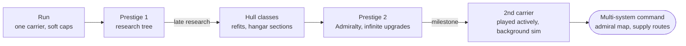
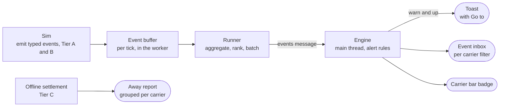

# Asteroid Fleet – Concept Follow-up (26 Oct 2026)

This follows up on `asteroid-fleet-game-concept.md`, the original concept. It is based on the repo **deadronos/asteroid-fleet at commit `c69690d`** ("Keep ships at the carrier when the warp jump fires (#48)"). It covers a read-only review of that commit, two new design sections (late-game scaling and multiple carriers), and the current decisions and open questions.

Full concept page (always the latest version): https://cursor.com/canvas/store-ea02965e-23cd-421c-8861-01f9ca03d812/c7eb42e4-4f65-474f-b50f-e149684b9b42

**How to read this:** only items marked **Lars' decision** are decided. Everything marked _suggestion_ or _brainstorm_ is a proposal to discuss, not a spec.

## Contents

- [1) Repo review findings](#1-repo-review-findings)
- [2) Late Game & Scaling (brainstorm)](#2-late-game--scaling-brainstorm)
- [3) Multiple Carriers (design draft)](#3-multiple-carriers-design-draft)
- [4) Decisions so far vs. open questions](#4-decisions-so-far-vs-open-questions)

## 1) Repo review findings

Overall: CI is green and v0.0.3 is deployed. Almost all of the original concept is implemented. Still missing: short expeditions and async PvP (both listed in the README as not yet built). Rules exist only as fixed cards.

| #   | Finding                                                                                                                                                                                                                                                                                                                                    | Where                                                              | Recommendation (suggestion)                                                                                                                  |
| --- | ------------------------------------------------------------------------------------------------------------------------------------------------------------------------------------------------------------------------------------------------------------------------------------------------------------------------------------------ | ------------------------------------------------------------------ | -------------------------------------------------------------------------------------------------------------------------------------------- |
| 1   | **The README is stale.** It says the sim runs on the main thread and that ship modules, scouts and glTF models are not yet built. The sim now runs in a Web Worker. The scale-test header comment still says "main thread" too.                                                                                                            | `README.md:77`, `src/sim/scale.test.ts:6`                          | Update both to match the code.                                                                                                               |
| 2   | **The full state goes to the UI five times a second.** `sendState()` posts the whole `GameState` (a structured clone) at `UI_HZ = 5`. That cost grows with ship count, and with several carriers it would grow per carrier. This is the biggest scaling risk.                                                                              | `src/game/runner.ts:9`, `src/game/runner.ts:126-132`               | Send the focused carrier's state plus small summaries, or send diffs. This ties into step 4 of the multi-carrier order in section 3.         |
| 3   | **The RP divisor differs from the concept.** The code uses `RP_DIVISOR = 10_000` so a first run pays out in about an hour. The concept's placeholder was 1,000,000.                                                                                                                                                                        | `src/sim/config.ts:323-329`, `src/sim/actions.ts:264`              | **Open decision for Lars:** keep 10,000, go back to 1,000,000, or pick a value from playtests. Until then, leave the code as it is.          |
| 4   | **Few e2e flows.** Playwright covers only four flows: app load and settings, save through the worker plus reload, the no-WebGL fallback, and the 400-ship draw-call budget. Not covered: hangar loadout, stances and rules, warp (including losing ships left outside), prestige and research, offline settlement, and save export/import. | `e2e/smoke.spec.ts`, `e2e/render.spec.ts`                          | Add e2e tests for prestige, warp, offline and save import/export first, since they change saves and progression.                             |
| 5   | **Shallow rules.** There are only fixed rule cards, each with on/off and one parameter (the README calls this "a first step before building blocks"). Hangars are capped by a hardcoded literal `5`. Research has no infinite sink.                                                                                                        | `README.md:31,44`, `src/sim/actions.ts:125`, `src/sim/research.ts` | Rule depth is still an open question (section 4). Moving the hangar cap into `config.ts` helps whichever scaling path is chosen (section 2). |

Note: the README picked interim answers to the concept's four open questions (energy at zero, H2, reserves offline, rule depth). Those are build choices, not Lars' decisions. See section 4.

## 2) Late Game & Scaling (brainstorm)

> **Everything in this section is brainstorm.** Lars asked how to get past the hangar and slot hard caps: more carrier hulls, multiple carriers, or a second prestige layer with infinite upgrades. Nothing here is decided.

### Where the caps live today

| Limit               | Value                                                                              | Where (repo, 26 Oct)                                        |
| ------------------- | ---------------------------------------------------------------------------------- | ----------------------------------------------------------- |
| Hangars per carrier | 2 at start, hard max 5 (a literal, not in config)                                  | `src/sim/actions.ts:125`                                    |
| Slots per hangar    | 6 at start (+1 to +3 from Hangar frames research), max 12                          | `src/sim/state.ts:316`, `src/sim/config.ts:185`             |
| Cost curves         | Slot 120 × 1.45^(slots−6), new hangar 1,500 × 3^(n−2)                              | `src/sim/config.ts:183-184`                                 |
| Carriers            | Exactly one: the game state has a single `carrier`                                 | `src/sim/types.ts:257`                                      |
| Research            | 50 nodes, all with a max level (140 levels in total), so RP eventually has no sink | `src/sim/research.ts`                                       |
| Power and refinery  | Energy max 1,000, refinery max level 8                                             | `src/sim/config.ts:291-296`                                 |
| Sim budget          | 1,000 ships and 600 asteroids under 8 ms per tick, tested                          | `src/sim/scale.test.ts`                                     |
| Render budget       | 1,000 instances per ship class, 1,000 asteroids                                    | `src/render/Fleet.tsx:14`, `src/render/AsteroidField.tsx:9` |
| UI snapshot         | The full game state goes to the UI 5 times a second                                | `src/game/runner.ts:130`                                    |

So the fleet tops out around 60 hangar slots (5 × 12, plus barge drone bays) while the sim is tested at 1,000 ships. The cap is a design choice, not a performance wall: one carrier has roughly ten times headroom. Several carriers in several systems do not; they need abstraction.

### How other games handle it

| Game                  | Mechanic                                                                                                                           | Lesson for us                                                            |
| --------------------- | ---------------------------------------------------------------------------------------------------------------------------------- | ------------------------------------------------------------------------ |
| Antimatter Dimensions | Three prestige layers: Infinity → Eternity → Reality; each resets the ones below and opens a new upgrade system                    | Each layer needs a new mechanic, not just bigger numbers                 |
| Realm Grinder         | Abdication → Reincarnation → Ascension, each with its own requirement                                                              | Nested resets give a long tail                                           |
| NGU Idle              | Rebirth, plus difficulty modes Normal → Evil → Sadistic that unlock new content                                                    | A harder universe can be a layer of its own                              |
| Egg, Inc.             | Soul Eggs add a bonus, Prophecy Eggs compound it; contracts run on a separate farm beside the home farm                            | A second currency as a multiplier; a side operation next to the main one |
| Idle Planet Miner     | Sell a galaxy for credits; Mothership rooms persist across galaxies                                                                | A persistent ship as the meta layer fits a carrier                       |
| Kittens Game          | Paragon on reset: 1 point per kitten above 70                                                                                      | A simple, readable threshold payout                                      |
| Mindustry             | Unit cap comes from cores: Shard +8, Foundation +16, Nucleus +24, additive; on Erekir each core gives +15, so you build more cores | Exactly our case: cap per base, more or bigger bases raise it            |
| Homeworld Remastered  | Unit caps per ship family and per type, e.g. only a few carriers                                                                   | Per-class caps read as fiction, not an arbitrary wall                    |
| EVE Online            | Capital ships jump with jump drives; jump fatigue grows with distance                                                              | A cost on moving big ships instead of a cap                              |
| X4: Foundations       | Ships are assigned to a commander (Defend, Mimic …); miners can mine for a station                                                 | An admiral layer: give orders to commanders, not to ships                |
| Factorio: Space Age   | Space platforms fly between planets, collect asteroids, run scheduled routes                                                       | Mobile bases on routes, a model for secondary carriers                   |

Where it collapses:

- Number inflation: Antimatter Dimensions' layers open at 1.80e308; past that, numbers stop meaning anything to most players.
- UI overload: every layer adds tabs and currencies; the HTML panels are already the densest part of the game.
- Performance: a second fully simulated and rendered carrier doubles cost; a fifth one breaks the budget.
- Offline balance: several carriers earning offline multiply the 12-hour offline payout.

### Idea groups

| Group          | Idea (suggestion)                                                                                                                                                                   | Performance fit                                               |
| -------------- | ----------------------------------------------------------------------------------------------------------------------------------------------------------------------------------- | ------------------------------------------------------------- |
| (a) Hulls      | Hull classes with their own slot grids: light carrier (fast warp, few hangars), fleet carrier (more hangars), mining mothership (big refinery, few combat slots), bastion (shields) | Free: same sim, one carrier                                   |
| (a) Hulls      | Hull refit at a shipyard in a starter system; ships that still fit stay aboard                                                                                                      | Free                                                          |
| (a) Hulls      | Modular hangar sections beyond 5, each drawing power and upkeep instead of a hard limit                                                                                             | Fine up to the 1,000-ship budget                              |
| (a) Hulls      | A carrier tech branch: frame, reactor, bays, sensors                                                                                                                                | Free                                                          |
| (b) Carriers   | A second carrier, unlocked by a prestige-2 milestone                                                                                                                                | Only the active carrier is fully simulated and rendered       |
| (b) Carriers   | Actively played carriers with a background sim: carriers outside the viewed system run an aggregate model (throughput equation plus risk rolls); see Multiple Carriers              | Cheap: only the viewed system is fully simulated and rendered |
| (b) Carriers   | Supply routes: convoys between carriers, abstracted as a flow with an interception chance                                                                                           | Cheap: one number per route                                   |
| (b) Carriers   | Admiral layer: a strategic star map, doctrine presets per carrier, switch focus between carriers                                                                                    | UI cost, little sim cost                                      |
| (c) Prestige 2 | Admiralty: resets research, RP and discovered systems; keeps hulls, carriers and milestones; pays Admiralty Marks from lifetime RP                                                  | Free                                                          |
| (c) Prestige 2 | Infinite upgrades (yield, energy, launch speed) with geometric cost and a soft cap on the effect                                                                                    | Free; keep numbers readable                                   |
| (c) Prestige 2 | Milestones: 1st Admiralty unlocks hull classes, 3rd a second carrier, 5th a third carrier slot                                                                                      | Grows the abstraction need                                    |
| (c) Prestige 2 | Challenges: runs with restrictions (no fighters, half energy, deep space start) for permanent bonuses                                                                               | Free                                                          |
| (d) Soft caps  | Command points: each ship costs CP, the hull supplies CP; going over slows launches and lowers efficiency                                                                           | Bounds the fleet without a wall                               |
| (d) Soft caps  | Upkeep: every hangar and ship draws power, so the energy pool becomes the real cap                                                                                                  | Uses the existing power system                                |
| (d) Soft caps  | Logistics limits: more drones than barges and haulers can serve add nothing (the throughput equation already does this)                                                             | Free                                                          |
| (d) Soft caps  | Replace the 5-hangar and 12-slot maxima with steeper cost curves and diminishing returns                                                                                            | Free                                                          |

### Recommended ladder (suggestion)

Start with soft caps (command points and power upkeep), since they reuse the energy system and lift the wall at almost no cost. Hull classes come next as late prestige-1 content. A second prestige layer, Admiralty, then unlocks extra carriers. All of them are played actively; the ones outside the viewed system run on a background sim, so the render and sim budget stays one system wide.

### References for scaling

- [Antimatter Dimensions: prestige layers (Infinity, Eternity, Reality)](https://antimatterdimensions.wiki.gg/wiki/Prestige) (antimatterdimensions.wiki.gg)
- [Realm Grinder: Abdication, Reincarnation, Ascension](https://realm-grinder.fandom.com/wiki/Soft_Resets) (realm-grinder.fandom.com)
- [NGU Idle: Evil difficulty as a progression layer](https://ngu-idle.fandom.com/wiki/Evil_difficulty) (ngu-idle.fandom.com)
- [Egg, Inc.: Eggs of Prophecy compound the Soul Egg bonus](https://egg-inc.fandom.com/wiki/Earnings_Bonus/Eggs_of_Prophecy) (egg-inc.fandom.com)
- [Egg, Inc.: contracts on a separate farm](https://egg-inc.fandom.com/wiki/Contracts) (egg-inc.fandom.com)
- [Idle Planet Miner: selling galaxies and Mothership rooms](https://idle-planet-miner.fandom.com/wiki/Strategy_Guide) (idle-planet-miner.fandom.com)
- [Kittens Game: Paragon](https://wiki.kittensgame.com/en/general-information/resources/paragon) (wiki.kittensgame.com)
- [Mindustry: cores set the unit cap](https://mindustry.miraheze.org/wiki/Core) (mindustry.miraheze.org)
- [Homeworld Remastered: players on per-type unit caps](https://steamcommunity.com/app/244160/discussions/0/618457398960679464/) (Steam Community)
- [EVE Online: jump drives and jump fatigue](https://wiki.eveuniversity.org/Jump_drives) (EVE University Wiki)
- [X4: Foundations: station building and management](https://wiki.egosoft.com/X4%20Foundations%20Wiki/Manual%20and%20Guides/X4%3A%20Foundations%20Manual/Station%20Building%20And%20Management/) (wiki.egosoft.com)
- [Factorio: Space platforms](https://wiki.factorio.com/Space_platform) (wiki.factorio.com)

### Open questions on scaling

1. Decided (Lars, 26 Oct): extra carriers are played actively at the same time, with a background sim for other systems. See Multiple Carriers.
2. What does Admiralty reset: the whole research tree, or only RP and discovered systems?
3. Keep a visible fleet limit for readability (command points), or let power and upkeep be the only limit?
4. Infinite upgrades: let numbers run into e-notation, or keep them human-readable with soft caps?

## 3) Multiple Carriers (design draft)

> **Lars' decision (26 Oct):** Several carriers are played actively at the same time. The panels follow the selected carrier, switching carrier also switches the system view, carriers in other systems keep running in the background, and events from other systems arrive as toasts. Everything else in this section is a suggestion.

### What the repo has today

| Area                | Today                                                                                                                                                                                                                                | Where                                                               |
| ------------------- | ------------------------------------------------------------------------------------------------------------------------------------------------------------------------------------------------------------------------------------ | ------------------------------------------------------------------- |
| Event log           | `log(s, text, tone)` pushes plain strings into `GameState.log`, capped at 40, shown in the Log tab. Over 20 call sites, no event types, no carrier or system id                                                                      | `src/sim/state.ts:269`, `src/sim/types.ts:232`, `src/ui/App.tsx:66` |
| Toasts              | One toast at a time, 2.5 s, used only for command errors and engine messages                                                                                                                                                         | `src/game/engine.ts:26`, `src/ui/App.tsx:182`                       |
| Offline report      | `settleOffline` pays mining income × time × 0.5 (max 12 h), clears pirates, rebuilds reserves; returns seconds, credits, rebuilt                                                                                                     | `src/sim/actions.ts:289-328`                                        |
| Worker protocol     | In: init, cmd, speed, pause, prestige, replace, snapshot. Out: a typed-array `frame` after every pump with ticks, and the full `state` at most 5 times a second                                                                      | `src/game/protocol.ts`, `src/game/runner.ts`                        |
| Single carrier      | `GameState` holds one `carrier`, one `hangars`, `ships`, `pirates`, `asteroids`, one `systemId`, `warp`, `wave`, `storm`, `rng`. About 200 lines touch `s.carrier`, `s.ships`, `s.hangars` or `s.systemId` across sim, render and UI | `src/sim/types.ts:257-283`                                          |
| Commands            | No carrier id; every command acts on the one carrier                                                                                                                                                                                 | `src/sim/actions.ts:35-62`                                          |
| Left-behind systems | Depletion records of systems the carrier left (`fields`), a good base for background fields                                                                                                                                          | `src/sim/types.ts:156`                                              |
| Save                | Version 7 with a migration per version                                                                                                                                                                                               | `src/sim/state.ts:28`, `src/game/migrate.ts`                        |

What multi-carrier needs: move everything per-carrier into an `ops: Operation[]` array (carrier, hangars, ships, pirates, asteroids, containers, hazards, recon, systemId, warp, wave, storm, reserve timers, fx, rng and income averages); keep credits, research, unlocks, lifetime stats and the event log global; add a v7 → v8 migration that wraps today's state into `ops[0]`; give every command a `carrierId`; and key the render scene by the focused carrier's system.

### Selection model (suggestion)

| Element                      | Suggestion                                                                                                                                                                                 |
| ---------------------------- | ------------------------------------------------------------------------------------------------------------------------------------------------------------------------------------------ |
| Focus                        | One focused carrier at a time; its system is the system view. The focus is UI state, sent to the worker so it knows which carrier gets the full sim                                        |
| Switching                    | A carrier bar (one card per carrier with hull, energy, income and an event badge), hotkeys 1–9, and clicks on the tactical or star map. A short warp-style camera cut hides the scene swap |
| Bound to the focused carrier | Fleet, Hangars, Doctrine, Power and Carrier tabs, plus the HUD                                                                                                                             |
| Global                       | Research, prestige, credits, unlocks, settings and the event inbox (filterable by carrier)                                                                                                 |
| Resource pool (open)         | Suggested split: credits and research shared; ore, H2 and energy stay on each carrier, as `Carrier` already holds them                                                                     |

### Sim fidelity tiers (suggestion)

| Tier          | Who                                   | How it runs                                                                                                                                                                                                                                             | Cost                                                       |
| ------------- | ------------------------------------- | ------------------------------------------------------------------------------------------------------------------------------------------------------------------------------------------------------------------------------------------------------- | ---------------------------------------------------------- |
| A: full       | The focused carrier                   | Today's deterministic 10 Hz `step`, rendered, frames and UI snapshot                                                                                                                                                                                    | Today's budget (tested to 1,000 ships)                     |
| B: background | Every other carrier while you play    | An aggregate model at 1 Hz: yield per minute from the bottleneck (drones, barges, haulers, refinery), energy balance, wave and hazard timers; a wave resolves as a strength comparison plus a seeded roll, and losses come out of the loss buffer first | Microseconds per carrier; no ships moved, nothing rendered |
| C: offline    | All carriers while the game is closed | Tier B with risk off, at offline efficiency, capped at 12 h, like today's `settleOffline`                                                                                                                                                               | One call per carrier on load                               |

- A → B (focus leaves): snapshot the ship roster, hull values and field depletion into the carrier's record, measure income from its recent Tier A average, and drop positions.
- B → A (focus arrives): rebuild asteroids from the system seed plus the depletion record, put ships at the carrier with docked ships at their dock and launched ships placed near their last target, and spawn an active wave at the system edge. The camera cut hides the re-materialisation.
- Determinism: each carrier gets its own `rng`, so background rolls never shift the focused carrier's random stream. The results depend only on the save and the order of focus switches, so a replay stays reproducible.
- Budget: N carriers (e.g. up to 8), one at Tier A. The worker sends the full state of the focused carrier only, plus a small summary per other carrier. That also removes today's risk of the full-state clone growing with the fleet.

### Event pipeline (suggestion)

Each event carries `kind`, `carrierId`, `systemId`, `severity`, sim time `t`, a `count` and small data. The runner merges events with the same kind and carrier within about 5 seconds ("3 drones lost in Kepler-4"), ranks by severity, and sends a batch alongside the frame. The text is formatted in the UI, so `log()` call sites turn into `emit()`.

| Event                          | Severity | UI treatment                                            |
| ------------------------------ | -------- | ------------------------------------------------------- |
| HullCritical / EmergencyJump   | critical | Sticky toast with Go to, red badge, optional auto-pause |
| PiratesArrived                 | critical | Toast with Go to, red badge                             |
| PirateWaveIncoming             | warn     | Toast with countdown and Go to, badge                   |
| ShipLost (aggregated)          | warn     | Toast when it is a barge or 3+ ships, else inbox only   |
| EnergyLow                      | warn     | Badge and inbox; toast once per carrier                 |
| BargeFull / BargeFallback      | warn     | Badge and inbox                                         |
| StormStarted                   | warn     | Inbox; toast only for the focused carrier               |
| WarpReady / Warped             | info     | Toast for the carrier that jumped                       |
| WaveRepelled                   | good     | Inbox, clears the red badge                             |
| ReserveRebuilt / BufferRebuilt | good     | Inbox only, aggregated                                  |
| VeinFound                      | good     | Inbox only                                              |
| ResearchAffordable             | info     | Global badge on the Research tab                        |

Offline: Tier C writes the same events, and the away report groups them per carrier ("Kepler-4: +12,400 credits, 2 reserves rebuilt"). Since doctrine and rules already react on their own (recall on low shields, reserve warp energy, barge fallback), toasts are information, not a call to micromanage. Doctrine could gain per-carrier alert rules: for each event kind choose off, inbox, toast, toast + pause, or toast + focus.

### Implementation order (suggestion)

1. **Event bus and toasts on today's single carrier:** SimEvent type in `src/sim/types.ts`, `emit()` replacing `log()` in `src/sim/state.ts`, drain and batch in `src/game/runner.ts`, an events message in `src/game/protocol.ts`, a toast queue and inbox in `src/game/engine.ts` and `src/ui/App.tsx`.
2. **State refactor to ops[]:** Operation type, `step(global, op)` in `src/sim/tick.ts`, `carrierId` on every Command in `src/sim/actions.ts`, v8 migration in `src/game/migrate.ts`, still one carrier.
3. **Tier B background model:** new `src/sim/background.ts` with materialise and dematerialise; `settleOffline` reuses it as Tier C; determinism and handover tests.
4. **Carrier switching and UI:** a focus message in `protocol.ts`, state for the focused carrier plus summaries, carrier bar and hotkeys, Scene keyed by system in `src/render/Scene.tsx`, panels bound to the focus.
5. **Second carrier unlock:** a buy-carrier action behind an Admiralty milestone (a debug unlock earlier for testing), then supply routes and the star map.

### Open questions on multiple carriers

1. Do background carriers take full risk (real losses while you are not watching), or reduced risk like offline?
2. Shared resource pool, or credits shared and ore, H2 and energy per carrier?
3. May two carriers share a system? If so, both are Tier A when you view it, which doubles that system's cost.
4. Doctrine and rules: per carrier, or fleet-wide with per-carrier overrides?

## 4) Decisions so far vs. open questions

### Lars' decisions

| Topic                               | Decision                                                                                                                                                                                                                       |
| ----------------------------------- | ------------------------------------------------------------------------------------------------------------------------------------------------------------------------------------------------------------------------------ |
| Direction                           | Open, near-endless field is the core                                                                                                                                                                                           |
| Intervention                        | No direct orders during play; the player sets doctrine like an admiral                                                                                                                                                         |
| Control levers                      | Hangar loadout, stances, and simple rules                                                                                                                                                                                      |
| Camera                              | Free 3D camera plus a tactical view, as a toggle or automatic zoom-out                                                                                                                                                         |
| Combat and progression              | Safe starter systems; farther out, richer ores plus pirate waves and hazard zones                                                                                                                                              |
| Carrier movement                    | Slow sublight repositioning within a system, warp jump between systems or zones                                                                                                                                                |
| Warp back                           | The carrier can warp back to safer systems; ships outside the carrier at jump time are lost                                                                                                                                    |
| Losses                              | Destroyed ships are gone for good; prestige upgrades can grant a minimum buffer per ship class that regenerates on a cooldown                                                                                                  |
| Offline                             | Mostly safe: offline progress runs at reduced risk                                                                                                                                                                             |
| Pirate scaling                      | Mostly by distance from the starter systems, plus a cargo-heat factor for ore held by the fleet and carrier                                                                                                                    |
| Carrier power                       | An energy pool for refinery, warp, and shields; recharges slowly from solar, later boosted by H2 fusion from gas giants                                                                                                        |
| Prestige                            | A reset that pays a currency for a research tree: attribute and stat upgrades and/or per-ship-class upgrades                                                                                                                   |
| Prestige payout                     | One fixed, simple formula from ore value delivered and furthest zone reached                                                                                                                                                   |
| **Multiple carriers (new, 26 Oct)** | Several carriers are played actively at the same time. Panels follow the selected carrier, switching carrier switches the system view, carriers in other systems run in the background, and off-system events arrive as toasts |

### Open questions

**Original concept.** The current code's interim choice, taken from the README, is shown in brackets. It is not a decision.

1. Energy at zero: can the pool run dry, and what happens then? _(Code: shields stop regenerating and refining stops; solar keeps trickling, so the carrier is never stranded.)_
2. Is H2 also direct warp fuel, or does it only feed the fusion reactors? _(Code: fusion fuel only.)_
3. Do reserve ships keep rebuilding while offline? _(Code: yes, on their cooldown.)_
4. Rule depth: fixed rule cards, Gladiabots-style building blocks, or real scripting like Screeps? _(Code: fixed cards with one parameter each.)_

**Repo review**

5. RP divisor: 10,000 (code) vs. 1,000,000 (concept placeholder).

**Late-game scaling**

6. What does Admiralty reset: the whole research tree, or only RP and discovered systems?
7. Keep a visible fleet limit (command points), or let power and upkeep be the only limit?
8. Infinite upgrades: e-notation, or human-readable with soft caps?

**Multiple carriers**

9. Do background carriers take full risk, or reduced risk like offline?
10. Shared resource pool, or credits shared and ore, H2 and energy per carrier?
11. May two carriers share a system? (Both would be Tier A while viewed, which doubles that system's cost.)
12. Doctrine and rules: per carrier, or fleet-wide with per-carrier overrides?
